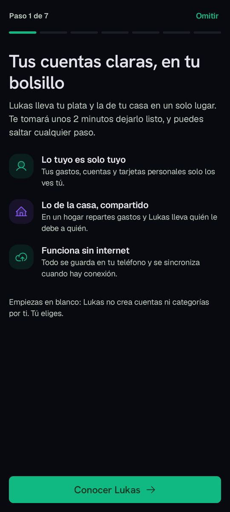
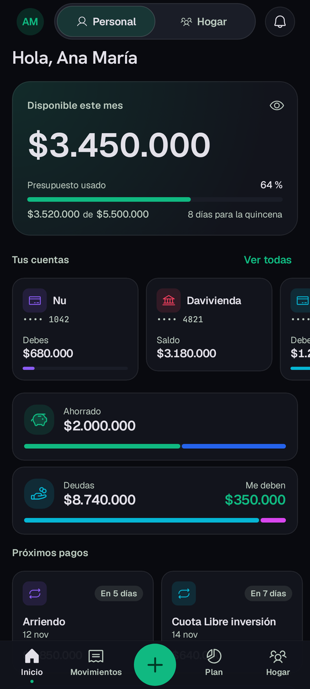
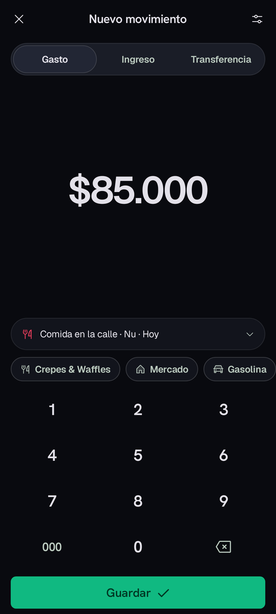
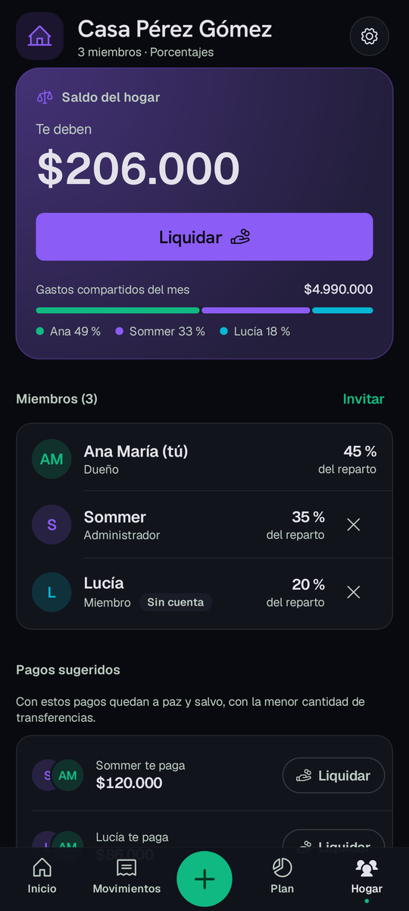
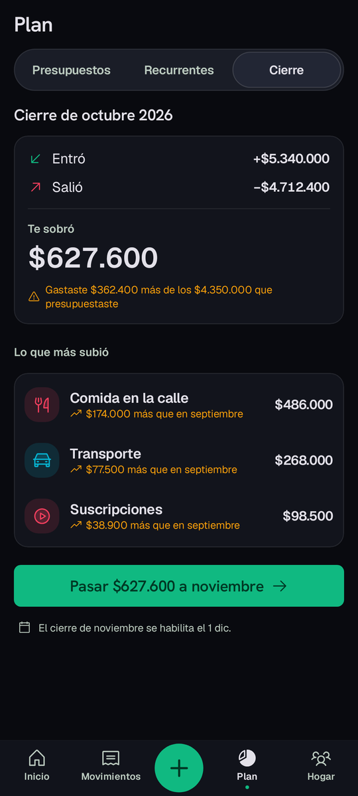
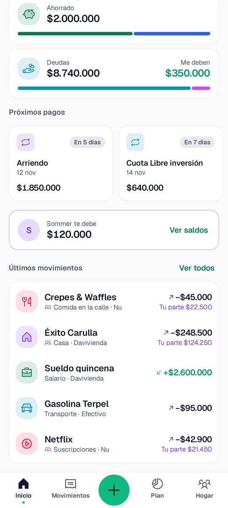
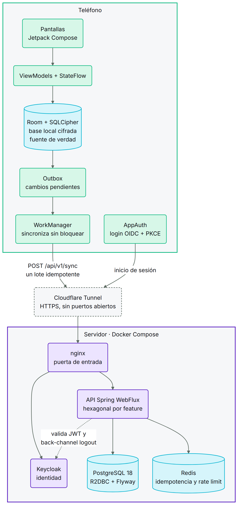

<!-- Generado automáticamente desde el repo privado (showcase/). No editar aquí: los cambios se pisan en la próxima publicación. -->

# Lukas: finanzas del hogar, local first

**Las cuentas claras del hogar, sin Excel.** Lukas es una app Android de finanzas personales y del hogar para Colombia. Cada persona lleva lo suyo, y lo de la casa se reparte entre varias personas. Funciona sin internet y sincroniza cuando hay conexión.

Es un proyecto personal que construyo de punta a punta: producto, diseño, app Android, API, infraestructura y operación en producción. El código vive en un repo privado; este repo muestra la arquitectura, las decisiones y el estado del proyecto, y **se actualiza solo** cada vez que avanzo.

> **In English:** Lukas is an offline-first household finance app for Colombia (Android + reactive Java API), built end to end by one engineer: product, design system, Kotlin/Compose app, Spring WebFlux backend, self-hosted infrastructure and security hardening. Source is private; this page is generated from it on every push.

| Componente | Versión | Estado |
| --- | --- | --- |
| App Android | `0.5.2` | En producción |
| API (backend) | `0.4.1` | En producción |
| Infraestructura | `0.3.0` | En producción |
| Web y landing | — | Scaffold (Angular 22, Astro 7) |

Última actualización: 2026-11-15 · desde el commit `d91f048` del repo privado.

## Capturas

Datos de demostración.

| Bienvenida | Inicio | Nuevo movimiento |
| :---: | :---: | :---: |
|  |  |  |
| **Hogar compartido** | **Cierre de mes** | **Tema claro** |
|  |  |  |

## Arquitectura

<picture>
  <source media="(prefers-color-scheme: dark)" srcset="diagramas/arquitectura-oscuro.png">
  
</picture>

- **Local first de verdad.** La UI solo lee de la base local cifrada. Toda escritura entra primero al teléfono y a un outbox; WorkManager la sincroniza en segundo plano. Sin red, la app funciona igual.
- **Un solo endpoint de sincronización.** Cada sync es una llamada: sube el outbox y baja todo lo que cambió desde el último cursor, paginado. Los ids nacen en el teléfono (UUIDv7), así un registro se crea sin red y nunca cambia de id.
- **Conflictos visibles, nunca silenciosos.** Concurrencia optimista con versión por fila. Si dos personas editan lo mismo sin red, la app muestra las dos versiones y la persona elige.
- **Backend hexagonal por feature.** 11 módulos de dominio (identidad, hogar, cuentas, movimientos, créditos, presupuestos, ahorro, sincronización…). El dominio es Java puro; las reglas de dependencia se verifican con ArchUnit en los tests.
- **Un servidor pequeño, bien medido.** Todo corre en una sola máquina con límites de memoria por servicio y un presupuesto de RAM documentado. Primero lo simple y correcto; caché o servicios nuevos solo con una medición que lo justifique.

## Stack

| Capa | Tecnología |
| --- | --- |
| Android | Kotlin, Jetpack Compose con sistema de diseño propio (sin Material), Hilt, Navigation 3, Room + SQLCipher, WorkManager, Retrofit/OkHttp, AppAuth, R8, Baseline Profiles |
| API | Java 25, Spring Boot 4 WebFlux, R2DBC, Flyway, Spring Security (resource server), Redis (Lettuce), OpenAPI |
| Identidad | Keycloak (OIDC + PKCE, rotación de refresh tokens, back-channel logout, tema propio) |
| Datos | PostgreSQL 18, Redis |
| Infra | Docker Compose (develop y producción), nginx, Cloudflare Tunnel, respaldos cifrados con prueba de restauración |
| Calidad | JUnit, Robolectric, Testcontainers, ArchUnit, Maestro (E2E), Macrobenchmark, SonarQube con quality gate de cero issues, gitleaks |
| Flujo | Monorepo con Gitflow por componente, CI de GitHub Actions con filtros por ruta, Conventional Commits |

## Decisiones técnicas

Una selección de los 14 registros de decisión (ADR) del proyecto.

<b>API reactiva con WebFlux + R2DBC, sin JPA</b>

Spring WebFlux con R2DBC en vez de MVC + JPA. A cambio de no tener lazy loading ni relaciones automáticas, cada consulta es explícita y se controla qué viaja a la base. Regla dura: nada bloquea el camino de una petición. Las pruebas de flujos reactivos usan `StepVerifier` y `WebTestClient`, y un test cuenta las consultas por petición para que no aparezcan N+1.

<b>Arquitectura hexagonal por feature</b>

Cada feature es un paquete con `domain` (Java puro), puertos de entrada y salida, casos de uso sin anotaciones de Spring y adapters (web, R2DBC, Redis). Las dependencias apuntan siempre hacia adentro y ArchUnit lo verifica en cada build. Más clases por feature, a cambio de casos de uso que se prueban con fakes y adapters intercambiables.

<b>Sincronización local first con conflicto visible</b>

Un solo `POST /api/v1/sync` por sincronización. Idempotencia en dos niveles: el lote, con `Idempotency-Key` en Redis, y cada operación, con su id guardado en la fila. Concurrencia optimista con versión por fila asignada por trigger. Los borrados son lógicos y viajan por el mismo feed. Un conflicto nunca se resuelve en silencio: el servidor devuelve su versión y la persona decide.

<b>Cada usuario es dueño de sus datos</b>

El dueño sale siempre del token, nunca del body ni del path. Toda consulta filtra por dueño en el mismo SQL y un recurso ajeno responde 404, no 403, para no revelar que existe. Cada endpoint tiene su test de IDOR. Datos mínimos: sin cédula, sin número completo de tarjeta, sin claves bancarias, sin datos personales en logs.

<b>Tokens: memoria, Keystore y back-channel logout</b>

En Android, el access token (15 min) vive solo en memoria y el refresh token se guarda cifrado con una llave AES-GCM no exportable del Android Keystore. Rota en cada uso, y reusarlo lo invalida. El backend valida firma, emisor, audiencia y que la sesión no esté revocada; la revocación llega por back-channel logout. La web futura usa el patrón BFF: el navegador nunca ve un token.

<b>Cero issues en SonarQube como definición de terminado</b>

Quality gate propio: 0 issues de cualquier severidad, 100 % de security hotspots revisados, cobertura ≥ 80 % y duplicación ≤ 3 %. Nada se suprime sin una razón escrita. Un cambio no está terminado hasta que el gate está en verde.

<b>Monorepo con componentes independientes</b>

Un solo repo para app, API, web, infraestructura y documentación, con la historia completa de los repos originales. Cada componente conserva su build, su versión SemVer y sus tags (`android/vX.Y.Z`, `backend/vX.Y.Z`). La CI corre solo lo que tocó cada cambio. Las reglas para agentes de IA están por nivel, así las de un componente no pisan las de otro.

## Qué hice yo

Soy el único desarrollador. Hice todo, de punta a punta:

- **Producto.** Investigación de apps de finanzas, análisis del flujo real de un hogar que llevaba sus cuentas en Excel, roadmap por fases y criterios de aceptación de cada módulo.
- **Diseño.** Un sistema de diseño propio (tokens de color, tipografía, espaciado y componentes), con temas claro y oscuro, contraste verificado por tests y onboarding en cada pantalla.
- **App Android.** Arquitectura local first, base de datos cifrada, sincronización con outbox, autenticación OIDC, desbloqueo biométrico, rendimiento medido con Macrobenchmark y Baseline Profiles.
- **API.** Diseño del contrato, dominio hexagonal, sincronización idempotente, aislamiento de datos por usuario y hogar, migraciones y pruebas de integración con contenedores reales.
- **Infraestructura y seguridad.** Producción en un servidor propio: hardening de Docker y del sistema, red segmentada, puerta de entrada nginx, túnel sin puertos abiertos a internet, respaldos cifrados y auditorías de seguridad de la app y del servidor.
- **Forma de trabajo.** ADR para cada decisión importante, Gitflow, quality gate de cero issues y barreras automáticas para que ningún secreto llegue a Git. Trabajo con agentes de IA (Claude Code y Codex) dentro de reglas, skills por componente y gates que yo definí: la IA acelera, y las decisiones y la revisión son mías.

## En números

| | |
| --- | --- |
| Tests automatizados | 2.336 (Android 1.470 · API 866) |
| Código de producción | 33.812 líneas de Kotlin · 9.739 líneas de Java |
| Migraciones de base de datos | 26 |
| Decisiones registradas (ADR) | 14 |
| Releases | 13 |
| Commits | 388 desde 2026-11-03 |

### Últimas versiones

| Componente | Versión | Fecha |
| --- | --- | --- |
| App Android | `0.5.2` | 2026-11-10 |
| API | `0.4.1` | 2026-11-10 |
| App Android | `0.5.1` | 2026-11-10 |
| App Android | `0.5.0` | 2026-11-10 |
| API | `0.4.0` | 2026-11-09 |
| App Android | `0.4.0` | 2026-11-09 |

---

© 2026 · Todos los derechos reservados. Este repo es una vitrina: no incluye el código fuente ni detalles operativos.
